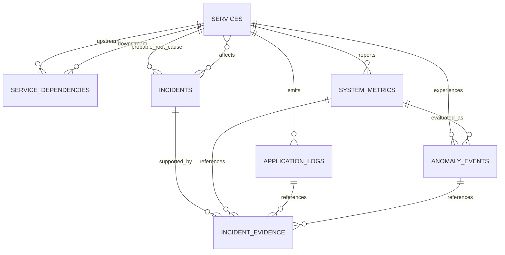

# Database Design

The backend uses SQLAlchemy 2.x models and Alembic migrations. PostgreSQL is the intended runtime database. The initial migration is also validated against SQLite for isolated tests; production deployment should use PostgreSQL.

## Entity relationships

## Tables

- `services`: unique service name, health state, and a flag identifying simulator-created services.
- `service_dependencies`: directed upstream/downstream edges with a composite primary key and a no-self-dependency check.
- `system_metrics`: timestamped resource, traffic, latency, error-rate, availability, and database connection measurements. Every row identifies its source as `SIMULATED`, `AGENT`, or `IMPORTED`.
- `application_logs`: structured messages with severity, error type, trace/request identifiers, optional JSON attributes, and an explicit source.
- `anomaly_events`: model version, prediction, normalized score, severity, optional source metric, and contributing feature evidence.
- `incidents`: lifecycle state, severity, root-cause candidate, affected services, deduplication key, explanation, and recommended actions.
- `incident_evidence`: timestamped evidence summaries and optional references to metrics, logs, anomaly events, or services.
- `ml_model_metadata`: model version, algorithm, dataset provenance, feature names, evaluation results, and artifact location.

## Constraints and indexes

UUID primary keys are used for independent entity records. Foreign keys define lifecycle behavior. Metric values have database checks for valid ranges and nonnegative counts; status, severity, log level, and source fields use check constraints. Service names and model name/version pairs are unique. Time-oriented composite indexes support service metric/log histories, anomaly histories, incident filtering, and evidence timelines.

The ORM uses SQLAlchemy parameter binding; request data must be validated by API schemas before persistence. Incident evidence stores explanatory snapshots as well as optional foreign keys so that investigations can retain useful context when linked telemetry is later removed.

## Retention

The environment template includes a configurable metrics retention period. Automated retention and cleanup are not implemented yet; until that worker is added, operators should not assume old metric/log rows are purged automatically.
